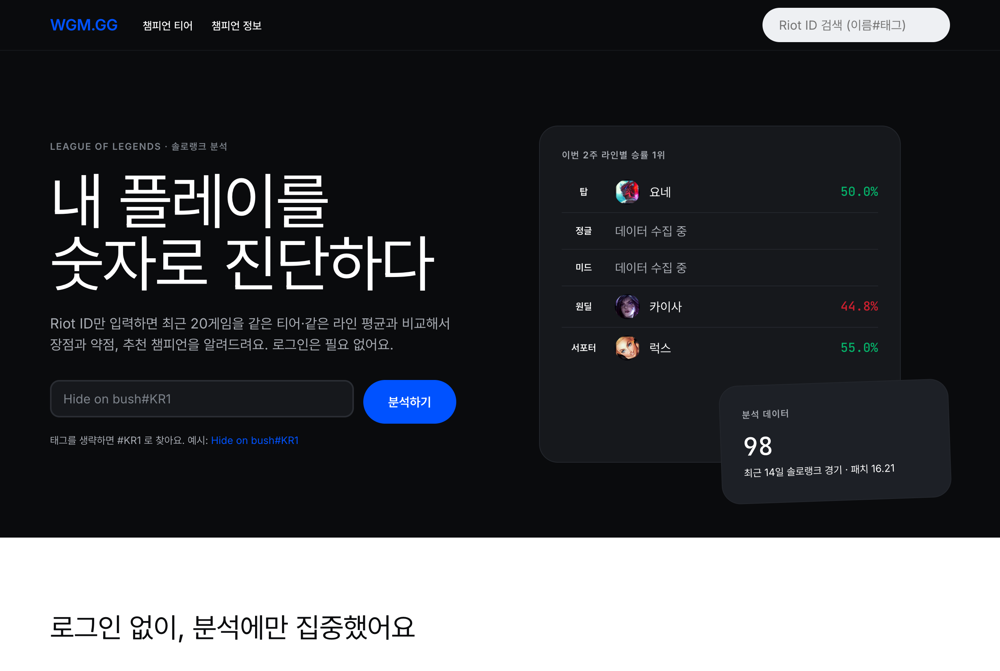
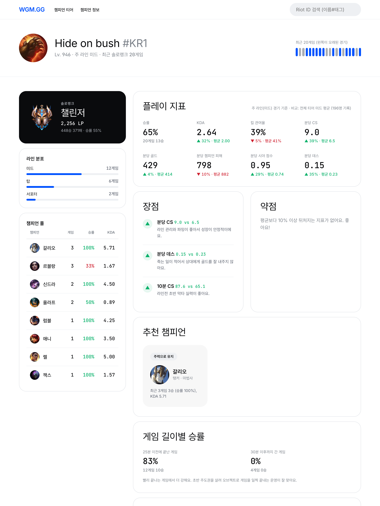
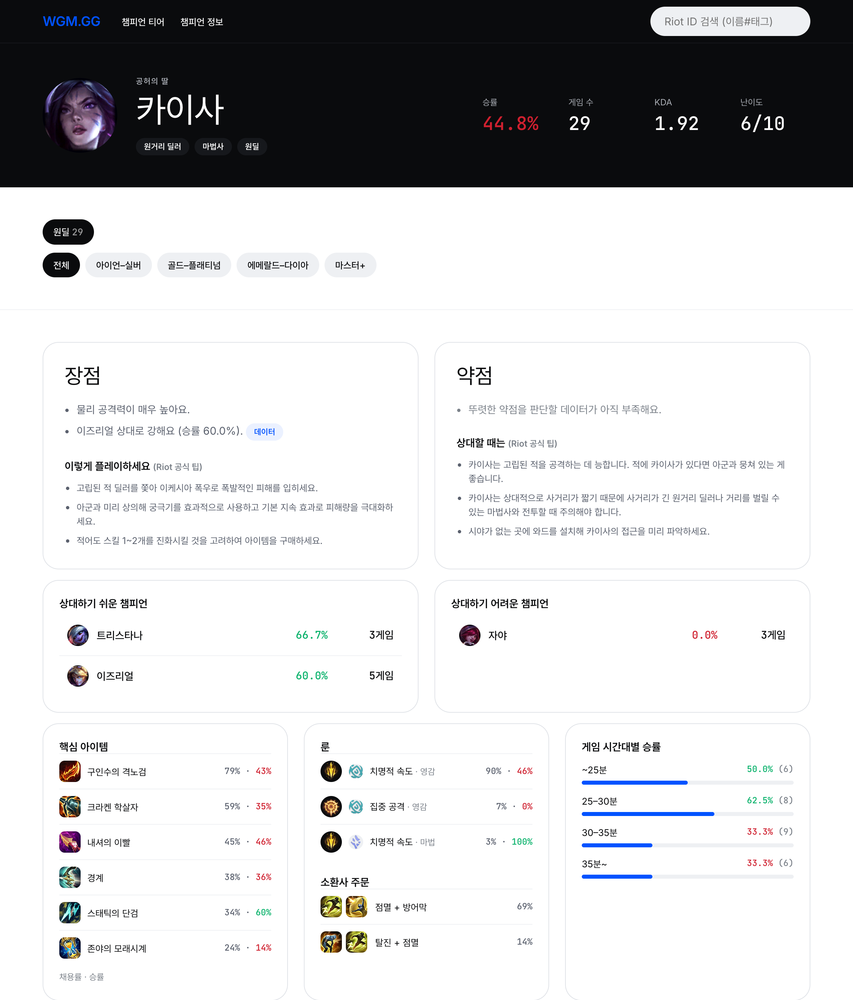
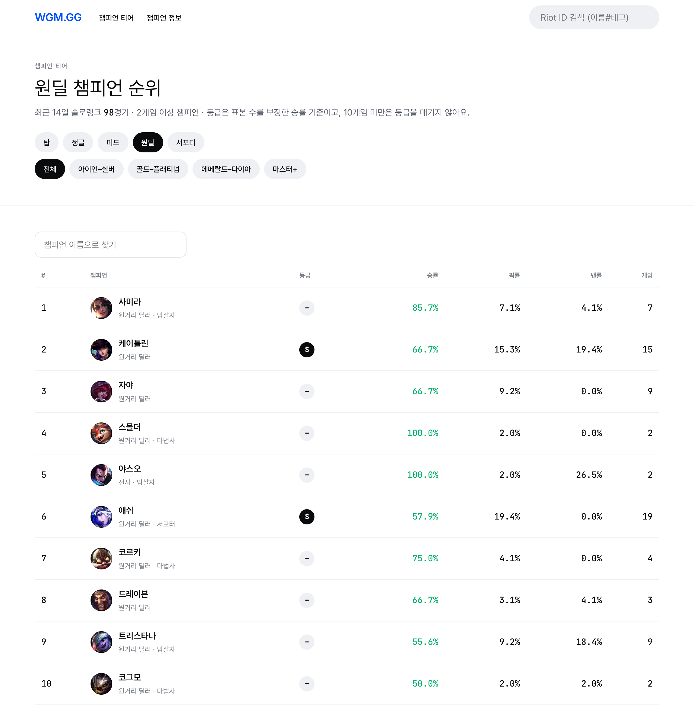
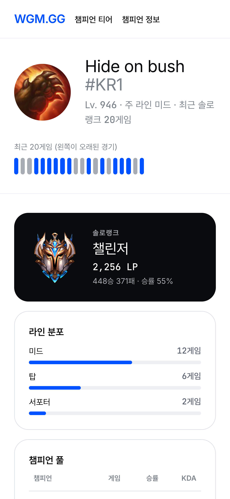

# WGM.GG - 우리 정글 뭐함?

로그인 없이 Riot API 데이터만으로 동작하는 리그 오브 레전드 전적 분석 사이트.

2020년 대학생 때 Python Flask + MongoDB로 만든 프로젝트를, 2026년에 AI(Claude Code)와 바이브 코딩으로 **작업 세션 한 번(약 3시간 20분)** 만에 되살리고 분석 플랫폼으로 갈아엎었다.

> **운영 안내**: 서비스로 운영하지 않는 포트폴리오·학습용 프로젝트다. 롤 전적 분석은 이미 op.gg가 대명사처럼 자리 잡았고, 의미 있는 통계를 내기 위한 데이터 규모와 운영 부담(Production 키 심사, API 한도, 패치별 데이터 관리)을 개인 프로젝트로 감당하기 어렵다고 판단했다.



## 기능

| 기능 | 내용 |
|---|---|
| **소환사 분석** | 최근 솔로랭크 20게임의 KDA, 킬 관여율, 분당 CS·골드·피해량, 시야, 데스를 **같은 티어·같은 라인 평균**과 비교해 장점/약점과 개선 팁을 보여 준다. 추천 챔피언(주력 유지 / 메타 추천 / 숙련도 활용), 게임 길이별 승률, 최근 경기 상세 |
| **챔피언 티어** | 라인 × 티어 구간(아이언–실버, 골드–플래티넘, 에메랄드–다이아, 마스터+)별 승률·픽률·밴률. 등급은 표본 수를 보정한 승률(베이지안 평균) 기준이고, 10게임 미만은 등급을 매기지 않는다 |
| **챔피언 정보** | Riot 공식 능력치·플레이 팁과 수집 데이터로 만든 장점/약점, 상대하기 쉬운·어려운 챔피언, 핵심 아이템·룬·주문, 게임 시간대별 승률, 스킬 설명 |
| **자동 수집** | Workers Cron이 5분마다 31개 티어 구간을 돌며 활발한 플레이어의 최근 14일 솔로랭크 경기를 모은다. 30일이 지난 경기는 삭제한다 |

| 소환사 분석 | 챔피언 정보 |
|---|---|
|  |  |

| 챔피언 티어 | 모바일 |
|---|---|
|  |  |

## 2020 → 2026

| | 2020 | 2026 |
|---|---|---|
| 런타임 | Python Flask (AWS EC2) | TypeScript + [Hono](https://hono.dev) (Cloudflare Workers + Cron) |
| DB | MongoDB Atlas | Supabase Postgres (RLS, 집계는 SQL 함수) |
| 로그인 | 이메일 회원가입 (bcrypt 직접 구현) | 없음 |
| Riot API | summoner/v4 by-name, match/v4 (폐지됨) | account-v1, summoner·league·mastery by-puuid, match-v5 |
| 챔피언 추천 | op.gg 크롤링 | 직접 수집한 경기 데이터로 집계 |
| 데이터 | 검색할 때마다 새로 요청 | 축약 저장(경기당 약 85KB → 3.5KB) + 재사용 |
| 화면 | MDB Bootstrap + Jinja2 | [DESIGN.md](DESIGN.md) 토큰 기반 자체 CSS + Hono JSX |

원본 Flask 코드는 [`legacy/flask`](legacy/flask)에 그대로 남겨 두었다.

## 작업 기록

| 문서 | 내용 |
|---|---|
| [1편: 되살리기](docs/blog-post.md) | 6년 전 코드 진단, Flask → TypeScript, MongoDB → Supabase, Cloudflare 배포 |
| [2편: 분석 플랫폼으로 개편](docs/blog-post-2.md) | 로그인 제거, 장단점 분석·티어표·챔피언 정보, 자동 수집, DESIGN.md 디자인 |
| [후기](docs/blog-post-final.md) | AI로 고쳐 본 소감과 서비스를 하지 않기로 한 이유 |
| [DEVLOG](DEVLOG.md) | AI에게 한 요청과 막혔던 부분을 순서대로 기록한 작업 로그 |
| [Riot API 키 신청 가이드](docs/riot-api-key-guide.md) | Development / Personal / Production 키 차이와 신청서 작성 예시 |

## 구조

```
src/
  index.tsx      라우트 + Cron 핸들러
  riot.ts        Riot API 클라이언트 (429 재시도, 동시 요청 제한)
  store.ts       match-v5 → 분석용 행으로 축약 저장 / 조회
  collector.ts   자동 수집
  analysis.ts    지표 계산, 장단점 비교, 추천 챔피언
  ddragon.ts     Data Dragon (챔피언/아이템/룬/주문)
  meta.ts        티어 구간, 라인, 등급
  views/         Layout, Home, Summoner, Champions(티어표/목록), Champion(상세)
supabase/migrations/
  0001_init.sql       1편 스키마
  0002_analytics.sql  2편 스키마 (1편 테이블 삭제 포함)
legacy/flask/    2020년 원본
docs/            블로그 글, 캡처, 키 신청 가이드
```

## 직접 실행해 보기

필요한 것: Node.js 20+, [Riot Developer Portal](https://developer.riotgames.com) API 키, Supabase 프로젝트

```bash
npm install
cp .env.example .dev.vars          # RIOT_API_KEY, SUPABASE_URL, SUPABASE_SECRET_KEY 채우기
```

Supabase SQL Editor에서 [`supabase/migrations/0002_analytics.sql`](supabase/migrations/0002_analytics.sql)을 실행한다.

```bash
npx wrangler dev --test-scheduled  # http://localhost:8787
curl "localhost:8787/__scheduled?cron=*/5+*+*+*+*"   # 자동 수집 1회 실행
```

Development 키는 24시간마다 만료된다.

---

WGM.GG isn't endorsed by Riot Games and doesn't reflect the views or opinions of Riot Games or anyone officially involved in producing or managing Riot Games properties. Riot Games, and all associated properties are trademarks or registered trademarks of Riot Games, Inc.
